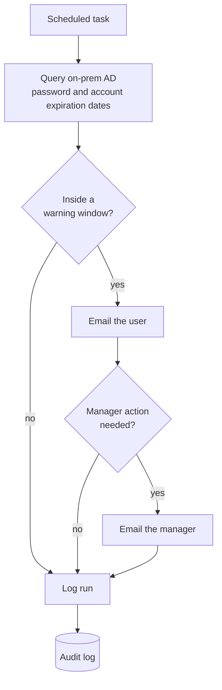

# Zero-Touch Identity: Password and Account Expiration Automation

**Case study** · Enterprise IT, ~2,600 users · Role: Supervisor, Onsite IT & Automation Systems (2024–2026)

Scheduled PowerShell automation that warned users and their managers before passwords and accounts expired, so they could act in time instead of getting locked out. "Zero-touch" refers to IT staff: once deployed, the process ran on its own schedule with no manual steps.

---

## Situation

About 2,600 users were managed in on-premises Active Directory, synced to Microsoft Entra ID through Entra Connect. Password and account expirations were handled reactively: people usually found out when they could no longer sign in, which meant lost work time and a service desk ticket.

Some of this was done by hand, but only on a very limited scale. Doing it for all ~2,600 users (checking expiration dates, contacting users, following up with managers) would have taken an estimated 380 hours a year, so it couldn’t be sustained at that scale.

## Task

Give users, and their managers where needed, enough warning to act before an expiration caused a problem, without adding manual work for IT.

## Action

I scoped and built a set of scheduled PowerShell scripts against on-premises Active Directory:

- **Detection:** scheduled runs query AD for passwords and accounts approaching expiration within defined warning windows.
- **Notification:** users are emailed directly with what is expiring, when, and what to do. Managers are notified where their action is needed, for example to extend an account.
- **Policy alignment:** warning windows and rules follow the organization's Security policies for password and account expiration.
- **Audit-ready logging:** every run and every notification is logged, so it's always possible to show who was warned and when.
- **Unattended operation:** the scripts run on a schedule with no manual steps.

## Result

- **9,000+ proactive notifications** sent to users and managers
- An estimated **380 hours a year** of manual tracking and follow-up covered by automation
- An estimated **up to 1,800 expiration-related service desk tickets** avoided
- A complete **audit trail** of every warning sent

## Lessons learned

- **Warn before the problem, not after.** Notifying people ahead of expiry turned a reactive ticket stream into something users handled themselves.
- **Include the manager when the user can't act alone.** Some expirations need someone else's approval, and routing those to the manager closed the loop.
- **Logging is what makes automation auditable.** A record of every notification answers "was this person told?" without anyone having to check by hand.
- **Simple scheduled automation can close a real governance gap.** This needed no new platform, only reliable scripts and a clear process.

## Background

This pattern grew out of an earlier proactive password-expiration notification tool I built as a consultant at Xantrion, which improved both compliance and user experience for client environments.
